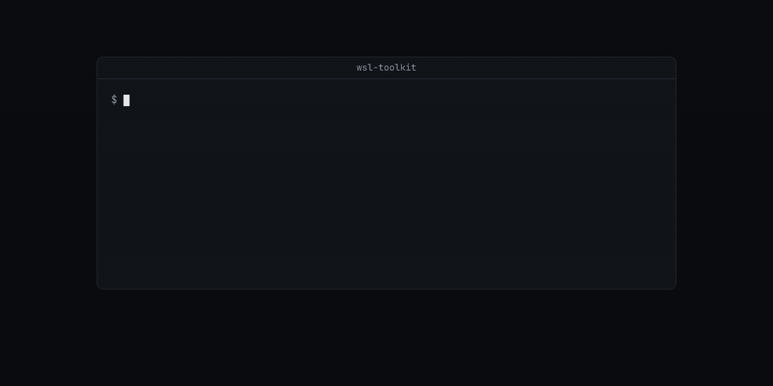

# wsl-toolkit

Get your disk space back from WSL.

Shell and PowerShell scripts that find and reclaim disk space in WSL 2, clean up Docker inside WSL, restart WSL and its apps, and route traffic through a WireGuard VPN container.



## Why

WSL 2 keeps each distro in an `ext4.vhdx` file on the Windows drive. The file grows when Linux writes data, but deleting files inside Linux does not make it smaller. Getting the space back on `C:` takes three steps: delete the data in Linux, run `fstrim` so ext4 releases the freed blocks, and compact the VHD from Windows while WSL is shut down. These scripts do each step and print the sizes before and after.

## Install

```bash
git clone <this repository> wsl-toolkit
cd wsl-toolkit
```

Requirements:

- WSL 2 with a Linux distro that has bash, `sudo`, GNU coreutils and `util-linux` (`fstrim`).
- Windows PowerShell 5.1 for the `.ps1` scripts. `fix-disk.ps1` and `wsl-defender-exclusions.ps1` need an elevated terminal.
- Docker Engine in WSL for `docker/` and `homelab-routing/`. `homelab-routing/` also needs Docker Compose v2 and a WireGuard config from a VPN provider.
- `wsl/wsl-shutdown.ps1` calls the Claude Code CLI (`claude.exe` by default).

## Quick start

Start with the read-only scan. It changes nothing:

```bash
disk/wsl-space-scan.sh
```

It runs `sudo du` over `/`, `/var` and `$HOME`, and `find` over all of `$HOME`, so it can take many minutes on a large disk. It takes no directory argument. The output below is trimmed. It comes from a run inside a sandbox whose home directory was a 4 GB folder:

```console
=== /home/demo subdirs (>200 MB) ===
4.0G	/home/demo
2.6G	/home/demo/_kit
1017M	/home/demo/cloudbox
348M	/home/demo/av

=== node_modules trees larger than 200 MB (under ~) ===
1007M  /home/demo/cloudbox/node_modules
250M  /home/demo/av/app/node_modules

=== Build/dist trees (target/, dist/, build/, .next/) larger than 200 MB ===
2.6G  /home/demo/_kit/frames/target
831M  /home/demo/_kit/frames/target/release/build
```

The scripts that delete data do nothing until you pass an explicit flag. Without it they print their usage and exit with code 2:

```console
$ disk/wsl-deep-clean.sh
Usage: disk/wsl-deep-clean.sh --clean [PATH ...]
Deletes PATHs, clears package caches and vacuums the journal to 200M, then runs fstrim.
$ docker/docker-cleanup.sh
Usage: docker/docker-cleanup.sh --prune
Prunes unused Docker data.
```

Check the VPN gateway without starting it:

```console
$ homelab-routing/menu.sh status
Homelab routing status

docker: Docker version 29.4.0, build 9d7ad9f
compose: Docker Compose version v5.1.2
wireguard config: missing

Put a provider WireGuard config here:
  /tmp/readme-proof/wsl-toolkit/homelab-routing/wireguard/wg0.conf

gateway: stopped
```

## How it works


The scripts are independent. The diagram shows the order they are meant to run in.

### Find

| Script | What it reads |
| --- | --- |
| `disk/wsl-space-scan.sh` | `df -h /`. Directories over 500 MB in `/` and over 200 MB in `/var` and `$HOME`. Sizes of apt, journal, snap, npm, pnpm, cargo, rustup, pip, uv, yarn, bun, deno, gradle, maven, `/tmp` and `/var/tmp`. The 20 largest `node_modules` trees and the 30 largest `target`, `dist`, `build`, `.next`, `.turbo`, `.venv`, `venv` and `__pycache__` trees over 200 MB under `$HOME`. |
| `docker/docker-list-images.sh` | Images used by any container, running or stopped, and the idle images that `docker image prune -af` would delete. |

### Delete inside Linux

| Command | What it deletes |
| --- | --- |
| `disk/wsl-deep-clean.sh --clean [PATH ...]` | Each `PATH` (`rm -rf`), then runs `pnpm store prune`, `npm cache clean --force`, `~/.bun/install/cache`, `uv cache clean` (or `~/.cache/uv`), `sudo apt clean` and `journalctl --vacuum-size=200M`. Ends with `sudo fstrim -av` and prints the GiB freed. |
| `docker/docker-audit.sh --prune` | Dangling build cache only (`docker builder prune -f`). Then lists every container, volume and volume size. |
| `docker/docker-cleanup.sh --prune` | All images that no container uses (`docker image prune -af`) and anonymous volumes (64-character hex names) that no container uses. Named volumes are kept. Ends with `fstrim -av`. |
| `docker/docker-final.sh --prune` | The containers in `REMOVE_CONTAINERS` and the images in `REMOVE_IMAGES`, then unused images and build cache. Ends with `fstrim -av`. |

`docker-cleanup.sh` and `docker-final.sh` run `sudo systemctl start docker` first.

### Shrink the VHD from Windows

Run these in Windows PowerShell, not in WSL. Each one runs `wsl.exe --shutdown` first, which stops every distro.

| Script | What it does |
| --- | --- |
| `disk/compact.ps1 -VhdPath <ext4.vhdx>` | Writes a diskpart script that attaches the VHD read-only, runs `compact vdisk` and detaches it. Logs the size before and after and the free space on `C:` to `%TEMP%\compact.log`. |
| `disk/compact-run.ps1 -VhdPath <ext4.vhdx> -DiskpartScript <file> -Distro <name>` | Dismounts the VHD if it is attached, runs `wsl --manage <name> --set-sparse true`, shuts WSL down again, and runs your diskpart script. |
| `disk/fix-disk.ps1 -VhdPath <ext4.vhdx> -PagefileInitialMB <MB> -PagefileMaximumMB <MB> -Apply` | Needs an elevated terminal. Deletes `C:\Windows\Logs\CBS` files, turns hibernation off (`powercfg /h off`), sets a fixed pagefile size, and compacts the VHD. Without `-Apply` it stops and changes nothing. The pagefile change takes effect after a reboot. |

### Manage WSL

| Script | What it does |
| --- | --- |
| `wsl/wsl-shutdown.ps1 [-ClaudePath <exe>]` | Waits 30 seconds, then asks the Claude Code CLI in print mode, limited to `wsl` commands, to run `wsl --shutdown` and `wsl --list --running`. Logs to `%TEMP%\wsl-shutdown.log`. |
| `wsl/restart.ps1 -Distro <name> -AppPath <exe> -ProcessName <name>` | Waits 25 seconds, starts the distro, stops the named Windows process, and starts the app again. |
| `wsl/kill-watcher.ps1 -CommandLinePattern <regex>` | Stops every `powershell.exe` whose command line matches the pattern. |
| `wsl/wsl-defender-exclusions.ps1 -Paths <path>,...` | Needs an elevated terminal. Adds Microsoft Defender exclusions for the paths and for `wsl.exe`, `wslservice.exe`, `wslhost.exe`, `vmmemWSL`, `docker.exe` and `dockerd.exe`, then lists all exclusions. It does not turn off real-time protection. |

### Route traffic through a VPN

`homelab-routing/` runs the `qmcgaw/gluetun` container with your WireGuard config and an HTTP proxy on port 8888.

```bash
cd homelab-routing
mkdir -p wireguard && cp <your-provider>.conf wireguard/wg0.conf
./menu.sh start    # copies config.example.env to .env if missing, then docker compose up -d
./menu.sh test     # your direct IP, then your IP through http://127.0.0.1:8888
./menu.sh stop
```

`menu.sh` also accepts `status` (the default) and `logs`. `scripts/start.sh`, `scripts/stop.sh` and `scripts/test.sh` do the same as `start`, `stop` and `test`.

## Configuration

| Name | Used by | Default | What it does |
| --- | --- | --- | --- |
| `PATH ...` arguments | `wsl-deep-clean.sh` | none | Paths to delete before the caches are cleared. |
| `REMOVE_CONTAINERS` | `docker-final.sh` | empty | Space-separated container names to remove. |
| `REMOVE_IMAGES` | `docker-final.sh` | empty | Space-separated images to remove. |
| `-VhdPath` | `compact.ps1`, `compact-run.ps1`, `fix-disk.ps1` | required | Windows path of the distro's `ext4.vhdx`. |
| `-DiskpartScript` | `compact-run.ps1` | required | diskpart script that selects and compacts your VHD. |
| `-Distro` | `compact-run.ps1`, `restart.ps1` | required | WSL distro name. |
| `-PagefileInitialMB`, `-PagefileMaximumMB` | `fix-disk.ps1` | required | Fixed pagefile size. |
| `-Apply` | `fix-disk.ps1` | off | Required before the script changes anything. |
| `-LogPath` | `compact.ps1`, `compact-run.ps1`, `fix-disk.ps1`, `restart.ps1`, `wsl-shutdown.ps1` | a file in `%TEMP%` | Log file. |
| `-ClaudePath` | `wsl-shutdown.ps1` | `claude.exe` | Claude Code CLI to call. |
| `-AppPath`, `-ProcessName` | `restart.ps1` | required | App to start again and the process to stop first. |
| `-CommandLinePattern` | `kill-watcher.ps1` | required | Regular expression matched against `powershell.exe` command lines. |
| `-Paths` | `wsl-defender-exclusions.ps1` | required | Folders to exclude from Defender scans. |
| `homelab-routing/.env` | `compose.yml` | copied from `config.example.env` | gluetun settings: `VPN_SERVICE_PROVIDER=custom`, `VPN_TYPE=wireguard`, `HTTPPROXY=on` on `:8888`, `DOT=on`, `BLOCK_MALICIOUS=on`. |
| `homelab-routing/wireguard/wg0.conf` | `compose.yml` | none | Your VPN provider's WireGuard config, mounted read-only. |

`.env`, `*.log`, `homelab-routing/wireguard/` and `homelab-routing/gluetun/` are git-ignored.

## Limits

- The scripts target WSL 2 on Windows. The Linux scripts run on plain Linux, but there is no VHD to compact.
- `wsl-space-scan.sh` always scans `/` and all of `$HOME`. It has no option to scan a smaller tree.
- `compose.yml` publishes port 8888 on every host interface, not only on `127.0.0.1`. Anyone who can reach the machine on that port can use the proxy.
- `docker-cleanup.sh` removes every image that no container uses, including images you pulled on purpose. Run `docker-list-images.sh` first.
- Only `wsl-space-scan.sh` (in a sandbox), the usage output of the guarded scripts, and `menu.sh status` were run while this README was written. The cleanup, Docker, PowerShell and VPN scripts were not run.

## License

MIT. See [LICENSE](LICENSE).
